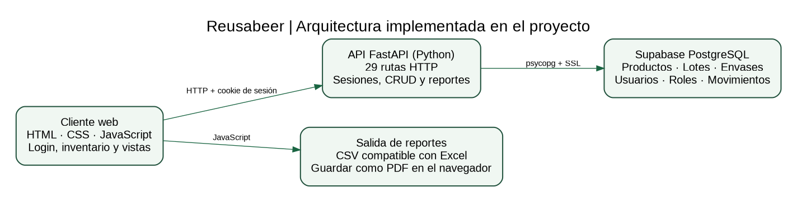

# Reusabeer

**Sistema web de gestión de envases retornables, inventario y sostenibilidad para pymes del sector de bebidas.**

Proyecto académico de **Electiva I — Python**, Tecnología en Desarrollo Informático, Universidad ECCI, Grupo 10 (2026).

> **Estado del proyecto:** la versión entregada incluye frontend, API FastAPI, persistencia en PostgreSQL/Supabase y componentes de autenticación. Las capturas académicas y el código respaldan los módulos; las pruebas completas con credenciales y base de datos deben revisarse en el entorno del equipo. El sistema está preparado para ejecutarse localmente; **GitHub no aloja la aplicación web**.

## Documentación para la profesora

**[Abrir índice de documentación del Corte 3](docs/README.md)**

- [Informe académico APA 7 (PDF)](docs/Documentos/Informe_Final_Reusabeer_APA7.pdf)
- [Anexo de evidencias (PDF)](docs/Documentos/Anexo_Evidencias_Reusabeer_APA7.pdf)
- [Guion del video y exposición (PDF)](docs/Documentos/Guion_Video_y_Exposicion_Reusabeer_APA7.pdf)
- [Presentación de 11 diapositivas (PDF)](docs/Presentacion/Presentacion_Final_Reusabeer.pdf)
- [Requerimientos (Excel)](docs/Matrices/01_Requerimientos_Reusabeer_Final.xlsx)
- [Historias de usuario (Excel)](docs/Matrices/02_Historias_Usuario_Reusabeer_Final.xlsx)
- [Seguimiento Scrum (Excel)](docs/Matrices/03_Scrum_Reusabeer_Cierre.xlsx)
- [Pruebas (Excel)](docs/Matrices/04_Matriz_Pruebas_Reusabeer_Final.xlsx)
- [Respuestas del Corte 3 (Excel)](docs/Matrices/05_Respuestas_Excel_Corte3_Final.xlsx)

## Funcionalidades

- **Autenticación:** formulario de ingreso, consulta de sesión, cierre de sesión y contraseñas con hash bcrypt.
- **Envases:** alta, edición, consulta, eliminación, historial de movimientos y trazabilidad por código.
- **Inventario y lotes:** existencias, registros, ajustes y vencimientos.
- **Producción:** registro de procesos, eficiencia y mermas.
- **Residuos:** destinos y clasificación dentro del flujo de producción.
- **Panel y reportes:** indicadores y reportes mensuales de sostenibilidad; descarga **CSV compatible con Excel** e impresión/guardar como **PDF** desde el navegador.
- **Administración:** usuarios, activación/desactivación, roles y edición de asociaciones `rol_permiso`.

**Nota de seguridad:** el backend autentica el acceso general a la API, pero la comprobación de permisos por rol en cada endpoint no está acreditada. Para una puesta en producción se requiere revisar autorización detallada, cookie `Secure`, configuración HTTPS y control de bloqueo por intentos.

## Arquitectura y herramientas

| Capa | Tecnología |
|---|---|
| Frontend | HTML, CSS y JavaScript |
| API y validaciones | Python, FastAPI y Pydantic |
| Ejecución de API | Uvicorn |
| Persistencia | PostgreSQL/Supabase, psycopg y SSL |
| Contraseñas y sesión | bcrypt; cookie HttpOnly con firma HMAC-SHA256 |
| Gestión del proyecto | Git, GitHub, Scrum/Kanban |



## Ejecutar localmente

Se requiere Python, un PostgreSQL/Supabase con las tablas del proyecto y credenciales propias. **El repositorio no incluye una base de datos pública ni cuentas de prueba**.

1. Copia `backend/.env.example` a `backend/.env` y completa los valores reales en tu computador. **No publiques el archivo `.env`.**
2. En una terminal, desde `backend`, crea y activa tu entorno virtual, instala las dependencias y ejecuta:

   ```powershell
   python -m venv .venv
   .\.venv\Scripts\Activate.ps1
   pip install -r requirements.txt
   uvicorn main:app --reload --host 127.0.0.1 --port 8000
   ```

3. En otra terminal, desde la raíz del proyecto, ejecuta el servidor estático:

   ```powershell
   python -m http.server 5500 --bind 127.0.0.1
   ```

4. Abre <http://127.0.0.1:5500> y, para la documentación automática de la API, <http://127.0.0.1:8000/docs>.

La instalación local requiere el esquema PostgreSQL y usuarios creados en la base de datos del equipo; el código por sí solo no carga datos automáticamente.

## Trabajo académico y evidencia

La documentación distingue **código revisado**, **capturas observables** y **pruebas pendientes de ejecución documentada**. No se presentan datos de producción ni se comparten credenciales. Consulta el [registro de revisión técnica](docs/REVISION_TECNICA.md).

**Repositorio del equipo:** <https://github.com/NicolasBece/reusabeer>
